# vue-uno-style

<p align="center">
  <a href="https://andrewbogdanovtss.github.io/vue-uno-style/">
    
  </a>
</p>

Let data from your CMS or API style an element differently on phones, tablets
and desktops, with plain CSS that UnoCSS generates at build time. Server-rendered
pages show the right value at every screen width before any JavaScript runs.

```vue
<h1 v-uno-style:c="{ sm: '#111827', md: '#4f46e5' }">Responsive heading</h1>
```

This heading is dark grey on phones and indigo from 768px up. The two colours
can come from anywhere: a CMS field, an API response, a user's settings.

## Why this exists

A CMS often lets editors style the blocks they place on a page: a heading's
colour, a section's background, the spacing around a card. Each setting can
take a different value per screen size, so a block's component receives data
like this:

```ts
{
  textColor: { sm: '#111827', md: '#ffffff' },
  background: { sm: '#ffffff', md: '#4f46e5' }
}
```

Two things make that hard to style:

- **You cannot know the classes in advance.** You write the component long
  before an editor picks the values.
- **The server cannot see the screen.** With Nuxt or any other server
  rendering, the HTML has to be right at every screen width before the browser
  runs any JavaScript.

Utility CSS such as UnoCSS works when you know the values while you write the
code. You write `md:c-indigo-600`, the build finds that class in your files, and
it generates the CSS for it. With values from a CMS, the usual approaches fall
short:

- **A utility class for the value**, such as `md:c-[#4f46e5]`, appears nowhere
  in your source, so the build never generated CSS for it. Safelisting every
  value is no way out either: an editor can pick any colour.
- **An inline style** (`style="color: #4f46e5"`) works, but inline styles have no
  media queries. You get one value for every screen.
- **Runtime CSS-in-JS**, or UnoCSS's own runtime, works, but ships a styling
  engine to the browser and writes new CSS rules while the page runs.

vue-uno-style takes the data as it comes:

```vue
<section
  class="c-gray-900 bg-white"
  v-uno-style="{ c: block.textColor, bg: block.background }"
>
  <h2>{{ block.title }}</h2>
</section>
```

The preset finds `c` and `bg` in the template and generates their CSS at build
time. The server renders the section with its classes and variables already
set, and when an editor leaves a field empty, the template's own classes apply.

## How it works

The value goes into a CSS variable. A small, fixed set of classes, generated at
build time, decides which variable applies at which screen width:

```html
<!-- what the directive renders -->
<h1 class="vs:c-$c vs:md:c-$c-md" style="--c: #111827; --c-md: #4f46e5">Responsive heading</h1>
```

```css
/* what the preset generated at build time */
.vs\:c-\$c { color: var(--c); }
@media (min-width: 768px) {
  .vs\:md\:c-\$c-md { color: var(--c-md); }
}
```

The classes depend only on the properties you set and the breakpoints you
configure, never on the values. Three properties and three breakpoints give nine classes, whatever
the CMS sends. When a value changes, only a CSS variable changes: nothing is
generated in the browser.

What that buys you:

- **Any value from data, per breakpoint.**
- **Correct HTML from the server.** The server writes the classes and variables
  into the element, and the media queries sit in a stylesheet built ahead of
  time. Each screen width shows its own value from the first paint, and
  hydration leaves the element as the server rendered it. Static generation,
  such as `nuxt generate`, works the same way.
- **Static CSS.** There is no styling engine in the browser. The directive only
  sets classes and CSS variables.
- **Defaults stay in the template.** A value from data overrides the element's
  own utility classes. When the data has no value, the template's class applies:

  ```vue
  <h1 class="c-gray-900" v-uno-style:c="cms.headingColor">Responsive heading</h1>
  ```

## When to use it

| Your values are | Use |
|-----------------|-----|
| known while you write the code | plain utility classes |
| from data, and the same on every screen | a plain `:style` binding |
| from data, and different per screen size | `vue-uno-style` |

## What's in the package

- **A Vue directive**, `v-uno-style`, that writes the classes and variables.
- **A UnoCSS preset** that generates their CSS at build time. You always need it:
  see [Properties](#properties).
- **An ESLint rule** that catches a second directive on the same element and a
  property that is neither configured nor a default one.
- **A Nuxt module** that wires them together.

Next on the [roadmap](https://github.com/AndrewBogdanovTSS/vue-uno-style/blob/main/ROADMAP.md):
`presetWind4`, values taken from your design system (`c: 'red-300'`), and a
Tailwind CSS 4 version.

See every behaviour live in the [playground](https://andrewbogdanovtss.github.io/vue-uno-style/).

## Install

```bash
npm install vue-uno-style unocss vue
```

Requires Node 24 or newer, Vue 3.4 or newer, and UnoCSS 66 or newer. The Nuxt
module also needs Nuxt 3.17 and `@unocss/nuxt` 66 or newer; the ESLint rule
needs ESLint 9 and `vue-eslint-parser`.

### Base presets

Any of the three UnoCSS presets with breakpoints works as the base:

| Preset | Breakpoints live in | Default `sm` | Rules you add |
|--------|---------------------|--------------|---------------|
| `presetMini` | `theme.breakpoints` | `640px` | `object`, `blur`, `columns`, `col-span`, if you use them |
| `presetWind3` | `theme.breakpoints` | `640px` | `col-span`, if you use it |
| `presetWind4` | `theme.breakpoint` | `40rem` | none |

The missing rules are listed under [Custom rules](#custom-rules). None of the
three defaults has a zero-valued `sm`, so each needs `baseBreakpoint: 'sm'` or
breakpoints of your own: see [Breakpoints](#breakpoints).

## Properties

A property is a UnoCSS utility prefix whose rule accepts a
`<prefix>-$<variable>` value: `c` for `color`, `mt` for `margin-top`. Each
property costs one class per breakpoint in the CSS, so the preset generates
classes only for the properties your app sets.

### Default properties

The package knows these properties without any configuration:

`c`, `bg`, `bgi`, `bgv`, `m`, `mt`, `mr`, `mb`, `ml`, `mx`, `my`, `p`, `pt`, `pr`, `pb`, `pl`, `px`, `py`, `gap`, `gap-x`, `gap-y`, `w`, `h`, `min-w`, `max-w`, `min-h`, `max-h`, `aspect`, `top`, `right`, `bottom`, `left`, `inset`, `z`, `order`, `flex`, `basis`, `rounded`, `opacity`, `text-size`, `leading`, `tracking`

The preset safelists a default property only once your source sets it, in one
of two forms:

```vue
<div v-uno-style:mt="cms.spacing" />
<div v-uno-style="{ px: cms.inset, 'gap-y': cms.rowGap }" />
```

An app that sets `mt` but never `mb` gets CSS for `mt` only. A default property
no template uses costs nothing.

`presetMini`, `presetWind3` and `presetWind4` each have a rule for every default
property except `bgi` and `bgv`. No base preset has a rule for those two, so
the preset adds its own:

| Prefix | CSS | Value |
|--------|-----|-------|
| `bgi` | `background-image: var(--bgi)` | A plain image URL. `bgi` takes `format: 'url'` unless its entry names a format, or `format: false` to take the value as written. |
| `bgv` | `background: var(--bgv)` | Any `background` value as written, such as a gradient. |

A rule of your own for `bgi` or `bgv` replaces the preset's.

> [!NOTE]
> Before 0.4.0, `bgi` had no format unless you gave it one. If yours is fed
> whole values such as `url(/a.png)` or a gradient, write
> `{ name: 'bgi', format: false }`, or they get wrapped a second time.

### What the preset finds in your source

The preset reads every file UnoCSS scans. By default that includes each `.vue`,
`.html`, `.jsx`, `.tsx`, `.svelte`, `.astro`, `.md` and `.mdx` file in your
build; UnoCSS's `content.pipeline` option narrows it. In the attributes of each
tag, it finds:

- **a static argument**: `v-uno-style:mt="..."`;
- **the top-level keys of an object literal**: `mt` and `px` in
  `v-uno-style="{ mt: ..., px: { sm: ..., md: ... } }"`, quoted keys and
  shorthand `{ mt }` included.

A directive registered as `unoStyle` is found as `v-unoStyle` and as
`v-uno-style`, the two spellings Vue resolves. HTML comments and escaped code
samples (`&lt;p v-uno-style:mb="..."&gt;`) do not count. A tag written out in
a Markdown code block does: keep such docs out of the scan if they show
properties your app does not use.

It cannot see a property whose name exists only at runtime:

- an object that is not a literal, such as `v-uno-style="block.styles"` or
  `v-uno-style="dark ? a : b"`;
- a dynamic argument, `v-uno-style:[name]`;
- a directive applied in a render function or in JSX through `withDirectives`.

> [!WARNING]
> A default property that reaches the directive only in one of these ways gets
> no CSS, and nothing warns: the directive knows the name, so it has nothing to
> report. List every property your data may set in `properties`.

In `nuxt dev`, a property you remove from the source stays safelisted until you
restart the dev server. A build always starts from scratch.

The scan costs little next to UnoCSS's own extraction. On a 174 KB file, it
takes 0.7 ms when the file uses the directive and 0.06 ms when it does not,
against 6 ms for UnoCSS's default extractor.

### Configured properties

`properties` lists properties the preset safelists always, whether the source
uses them or not. You need it in two cases:

- **The data names the property.** `v-uno-style="block.styles"` names nothing
  in the source. List every property such data may set.
- **The property is not a default one.** `blur` or `mask`, for example. List
  it, and add its rule when your preset lacks one: see
  [Custom rules](#custom-rules).

```ts
// vue-uno-style.properties.js (plain JS, so eslint.config.js can import it too)
export default [
  // Set by CMS data through v-uno-style="block.styles"
  'c', 'bg', 'p',
  // Not a default property
  'blur'
]
```

Your list is merged with the defaults:

| Property | Known to the directive, ESLint and WebStorm | Safelisted |
|----------|---------------------------------------------|------------|
| Configured | yes | always |
| Default, not configured | yes | once the source sets it |
| Neither | no: reported and warned about | never |

Listing a default property, such as `p` above, makes it safelisted always.
Leave it out to have the source decide.

`format: 'url'` wraps each value as `url(<value>)`, for properties fed plain
image URLs.

`defaultProperties: false` turns the defaults off. Only `properties` are then
known and safelisted, the source is not scanned for them, and `properties` is
required: the build fails without it. Pass the same `defaultProperties` to every
entry you configure yourself. The Nuxt module passes it on.

> [!IMPORTANT]
> The directive creates class names at runtime, so UnoCSS's own scanning cannot
> find them. Always install `presetVUnoStyle()` as well: it finds the properties
> your source sets, safelists their classes and the configured ones, and adds
> the `vs:` variant and its layer. See [The directive's layer](#the-directives-layer).

### Blocked properties

`blockedProperties` forbids properties across the project, default ones
included. Give an entry a `message` to say what to use instead:

```ts
// vue-uno-style.properties.js
export const blockedProperties = [
  'tracking',
  { name: 'opacity', message: 'Use op instead.' }
]
```

A blocked property is never known:

- **The preset** neither scans for it nor safelists it, so it has no CSS.
- **ESLint** reports it as a static argument and as a key of an object literal,
  with its message: `v-uno-style: Property "opacity" is blocked in this project. Use op instead.`
- **The directive** logs the same sentence in development builds, for values
  from data too. It still writes the class and the variable, which have no CSS.
- **The DevTools tab** shows it as a `blocked-property` warning.
- **WebStorm** no longer offers it.

Listing a property in both `properties` and `blockedProperties` throws. Pass
the same list to every entry you configure yourself; the Nuxt module passes it
on.

A UnoCSS `blocklist` entry such as `/^opacity-/` also removes the property's
CSS: UnoCSS checks the class again once `vs:` is stripped. Nothing but the
DevTools tab reports that, so forbid a property with `blockedProperties`.

### Custom rules

A property needs a UnoCSS rule that turns `<prefix>-$<variable>` into CSS.
Without one, its classes get no CSS, and nothing reports it: neither UnoCSS nor
the preset warns. When you add a property, check its CSS once.

Every rule has the same shape. The preset's variants remove `vs:` and the
breakpoint before the rule runs, so the rule only ever sees
`<prefix>-$<variable>`, and `name` is the variable without its `--`:

```ts
[/^<prefix>-\$([\w-]+)$/, ([, name]) => ({ '<css-property>': `var(--${name})` })]
```

Match the variable name with `[\w-]+` rather than `.+`: UnoCSS scans every file, and
text such as `mask-$*` would otherwise produce `var(--*)`, which fails CSS minification.

For a property fed plain image URLs, give its entry `format: 'url'`. The
directive then writes `url(<value>)` into the variable, so the rule stays a plain
`var()`:

```ts
// vue-uno-style.properties.js
export default [{ name: 'mask', format: 'url' }]
```

```ts
// uno.config.ts
rules: [
  [/^mask-\$([\w-]+)$/, ([, name]) => ({ 'mask-image': `var(--${name})` })]
]
```

#### Prefixes your preset lacks

`presetWind3` builds on `presetMini` and adds rules of its own; `presetWind4`
ships all four below. Among the common utilities, these prefixes need a rule
from you:

| Prefix | `presetMini` | `presetWind3` | `presetWind4` |
|--------|--------------|---------------|---------------|
| `object` | add the rule | built in | built in |
| `blur` | add the rule | built in | built in |
| `columns` | add the rule | built in | built in |
| `col-span` | add the rule | add the rule | built in |

```ts
// uno.config.ts - add only the rules your preset lacks
rules: [
  [/^object-\$([\w-]+)$/, ([, name]) => ({ 'object-fit': `var(--${name})` })],
  // The value can sit inside a CSS function...
  [/^blur-\$([\w-]+)$/, ([, name]) => ({ filter: `blur(var(--${name}))` })],
  [/^columns-\$([\w-]+)$/, ([, name]) => ({ columns: `var(--${name})` })],
  // ...or appear more than once.
  [/^col-span-\$([\w-]+)$/, ([, name]) => ({ 'grid-column': `span var(--${name}) / span var(--${name})` })]
]
```

> [!WARNING]
> A rule in your config replaces your preset's own rule for the same class, so
> add only the rules your preset lacks. Under `presetWind3`, for example, a custom
> `blur` rule sets `filter` on its own, which drops any other filter utility on
> the element.

### The directive's layer

Every class the directive writes starts with `vs:`. The preset's variant strips
it and puts the CSS in the directive's own UnoCSS layer, ordered after
`default`, so a value from data beats the element's ordinary utilities.

The layer is `v-uno-style` by default. Name it after your directive with
`layer`: the Nuxt module does that on its own, so `directiveName: 'style'`
gives `v-style`. Pass the same name if you also add the preset yourself.

The `vs:` variant and its layer belong to the package. A project's own
variant, such as an `o:` override layer, stays separate. The layer order
decides which of the two wins on a shared property:

```ts
// uno.config.ts - a project override layer that beats v-style values
layers: { override: 20 },
variants: [(matcher) => matcher.startsWith('o:') ? { matcher: matcher.slice(2), layer: 'override' } : undefined]
```

## Breakpoints

One breakpoint is the unprefixed base, used before any media query:

- A breakpoint valued `0`, `"0"`, `"0px"`, or `""` is selected automatically.
- If none has a zero value, `baseBreakpoint` is required.
- An explicit `baseBreakpoint` always wins.

The presets' own defaults start at `sm: 640px` (`presetMini`, `presetWind3`) or
`sm: 40rem` (`presetWind4`), so they need `baseBreakpoint: 'sm'` or a zero-valued
breakpoint. The package throws instead of guessing.

The package reads breakpoints where the base preset keeps them, the way
UnoCSS's own variants do:

- **The theme key** is `theme.breakpoint` under `presetWind4` and
  `theme.breakpoints` under the others.
- **Your theme value replaces the preset's defaults.** It is not merged with
  them: set `sm`, `md` and `lg`, and the defaults' `xl` and `2xl` are gone.
- **The `breakpoints` option replaces that theme key**, so the base preset's own
  variants use the same values. Set breakpoints in one place. If your theme sets
  them too, UnoCSS's variants follow the theme while the package follows the
  option, and the two must not disagree.
- **Theme values must be strings** (`'0px'`, not `0`): UnoCSS's own variants fail
  on numbers. The `breakpoints` option accepts numbers and converts them.

## Nuxt

```ts
// nuxt.config.ts
import properties from './vue-uno-style.properties.js'

export default defineNuxtConfig({
  modules: ['@unocss/nuxt', 'vue-uno-style/nuxt'],
  vUnoStyle: {
    properties,
    baseBreakpoint: 'sm',
    // directiveName: 'style', // register as v-style instead of v-uno-style
  }
})
```

The module adds the preset, reads breakpoints from the UnoCSS theme (or
`breakpoints`, when given) and registers the directive.

### Nuxt DevTools

During `nuxt dev`, the module adds a **vue-uno-style** tab to Nuxt DevTools:

- **Overview**: the resolved directive name, properties, formats and
  breakpoints, and where the breakpoints and the preset came from: the option or
  the theme key (`theme.breakpoint` or `theme.breakpoints`), and your other
  UnoCSS presets.
  - **Rule coverage.** It checks every safelisted class against your UnoCSS
    config: the configured properties', and the default ones the preset has
    found in the source so far. It flags a property with no matching rule and
    suggests the rule to add.
    For a prefix from [Prefixes your preset lacks](#prefixes-your-preset-lacks),
    that is the tested rule from the table. For any other prefix, it is the
    general shape with the CSS property left for you to fill in.
  - **UnoCSS blocklist.** It lists every known property, configured or default,
    with a class an entry of your UnoCSS `blocklist` removes, at any
    breakpoint, with the classes, the entry and its message. Coverage names
    that entry instead of suggesting a rule.
  - **Status.** It also shows the safelist size, configured and found in the
    source counted apart, the web-types status, the
    blocked properties, and which properties no page has used yet this session.
    The tab sees what the preset found only when the module added the preset.
    One you add in your UnoCSS config scans on its own, and the tab counts the
    configured properties alone.
- **Elements**: every element on the current page that carries the directive.
  For each one it shows the owning component, the value per breakpoint with the
  active breakpoint marked, each binding's classes and variables, and what one
  binding overrides in another. You also see the final `class` and `style` on
  the element and how often it updated. Hover a row to outline the element on
  the page. Turn on **Highlight active** to keep the selected element outlined
  while you work in the tab; the outline follows the element as the page
  scrolls.
- **Warnings**: values that give no CSS or the wrong CSS without an error. That
  covers a property that is neither configured nor a default one, a breakpoint key that does not
  exist, and a value that is neither a string nor a number. See [Warnings tab](#warnings-tab) for each kind and
  [Values that produce no CSS](#values-that-produce-no-css) for what the
  directive does with them.
- **Timeline**: the last 200 mounts, updates and unmounts, with the variables
  each one changed and how long the directive took. The timing covers every
  binding on the element and leaves out the tab's own bookkeeping. Browsers
  round it to 0.1 ms, so most events read `< 0.1 ms`; 1 ms or more is marked.
- **REPL**: runs a value through the directive and your UnoCSS generator and
  shows the classes, variables and CSS.

#### Warnings tab

The tab checks every binding when its element mounts and each time it updates.
It lists the warnings of the elements on the current page, one row per warning:
the element, the kind and a message. Click the element to open it in
**Elements**. The number of warnings shows next to the tab name.

| Kind | When | Example |
|------|------|---------|
| `blocked-property` | The property is in `blockedProperties`. The message says what to use instead. | `v-uno-style:opacity="'0.5'"` |
| `unknown-property` | The property is neither in `properties` nor a default one. The preset does not safelist its classes. | `v-uno-style:blur="'4px'"` |
| `unknown-breakpoint` | A key is not one of your breakpoints. The directive drops its value. | `{ sm: '1rem', tablet: '2rem' }` |
| `invalid-value` | A value is neither a string nor a number, or the directive has no argument and the value is not an object. | `v-uno-style:c="true"`, `v-uno-style="'red'"` |

An empty value (`''`, `null`, `undefined` or `false`) gives no warning. It is
the normal way to leave a property or a breakpoint unset.

In development the directive is wrapped to report to the tab, on the client
only. Production builds and server rendering use the plain directive.
`devtools: false` leaves the tab out.

## Vue and UnoCSS without Nuxt

Give the preset and the directive the same properties and breakpoints, and the
preset the name you register the directive under, when it is not `uno-style`:

```ts
// uno.config.ts
import { defineConfig, presetWind3 } from 'unocss'
import { presetVUnoStyle } from 'vue-uno-style/preset'
import properties from './vue-uno-style.properties.js'

export default defineConfig({
  // The same with presetMini() or presetWind4(): the option writes the
  // breakpoints into the theme key the base preset reads.
  presets: [
    presetWind3(),
    presetVUnoStyle({ properties, breakpoints: { sm: 0, md: '768px', lg: '1024px' } })
  ]
})
```

```ts
// main.ts
import { createVUnoStyle } from 'vue-uno-style'
import properties from './vue-uno-style.properties.js'

app.directive('uno-style', createVUnoStyle({
  properties,
  breakpoints: { sm: 0, md: '768px', lg: '1024px' }
}))
```

Passing `properties` to the directive applies their formats and warns in
development about a property that is neither configured nor a default one. Pass
`[]` when you configure none: the directive then still knows the defaults.

## Usage

Use an argument for one property, or an object for several:

```vue
<template>
  <article
    v-uno-style="{
      c: { sm: '#111827', md: '#ffffff' },
      bg: { sm: '#ffffff', md: '#4f46e5' }
    }"
  >
    <p v-uno-style:p="'1rem'">Body</p>
  </article>
</template>
```

A scalar applies to the base breakpoint. Adjacent breakpoints with the same
value collapse into one class.

A single-root component may carry the directive on its root while its usage
site applies another. Both apply, and the usage site wins a shared property.

### Values that produce no CSS

The directive does not throw on a value it cannot use. What it does instead:

- **Empty values.** `''`, `null`, `undefined` and `false` write nothing. Use
  them to leave a property or a breakpoint unset. `false` makes
  `v-uno-style:h="fixedHeight && height"` work: when `fixedHeight` is false, the
  element keeps the height its own classes give it. `0` is a value and writes
  `0`.
- **A key that is not a breakpoint.** With `sm`, `md` and `lg`, the value for
  `tablet` in `{ sm: '1rem', tablet: '2rem' }` is dropped. Only your
  breakpoints are read.
- **A property that is neither configured nor a default one.** The class and
  the variable are still written (`vs:blur-$blur`, `--blur`), but the preset
  does not safelist the class, so it has no CSS. When the directive has
  `properties`, development builds log
  `[vue-uno-style] Property "blur" is neither configured nor a default property, so its classes are not safelisted.`
- **A default property the source never sets.** `v-uno-style="block.styles"`
  with `{ mb: '1rem' }` writes `vs:mb-$mb`, but no template sets `mb`, so the
  preset did not safelist it. Nothing warns. See
  [What the preset finds in your source](#what-the-preset-finds-in-your-source).
- **`true`.** It is never a CSS value, so it writes nothing, like `false`.
  Unlike `false`, the [Warnings tab](#warnings-tab) reports it as an invalid
  value, since it usually means a mistake in the binding.
- **Another value that is neither a string nor a number.** It is written as
  text: an object sets `[object Object]`. The CSS gets a value it cannot use.
- **No argument and a value that is not an object.** `v-uno-style="'red'"`
  reads the string as an object of characters. It writes the classes
  `vs:0-$0 vs:1-$1 vs:2-$2` and the variables `--0: r`, `--1: e`, `--2: d`. With
  `properties`, development builds also log the unknown-property warning
  for `0`, `1` and `2`.

In `nuxt dev`, the [Warnings tab](#warnings-tab) of Nuxt DevTools lists each of
these except empty values, with the element they came from.

## ESLint

`vue-uno-style/no-multiple-v-style` reports more than one directive on a tag
and autofixes adjacent ones into the object form. It also reports a static
argument or object literal key that is neither a default property nor in
`properties`. Pass your `properties` so it knows them; an empty list is fine.

```js
// eslint.config.js
import vUnoStyle from 'vue-uno-style/eslint'
import vueParser from 'vue-eslint-parser'
import properties from './vue-uno-style.properties.js'

export default [
  ...vUnoStyle.configs.recommended,
  {
    files: ['**/*.vue'],
    languageOptions: { parser: vueParser },
    rules: {
      'vue-uno-style/no-multiple-v-style': ['error', { properties }]
    }
  }
]
```

Pass `directiveName` as well when the directive is registered under another
name.

## WebStorm completion

The package ships a [web-types](https://github.com/JetBrains/web-types) file,
so WebStorm completes `v-uno-style`. The Nuxt module rewrites it inside the
installed package with your `directiveName` and `properties`, so completion
offers your properties and the defaults. The shipped file offers the defaults. Nothing is written to your project.

The file is replaced rather than edited, so pnpm's shared store stays intact.
A read-only or missing `node_modules` (Yarn PnP) only logs a warning. Two apps
sharing one installed copy overwrite each other's file. `webTypes: false`
turns the rewrite off; `createWebTypes()` builds the file for setups without
Nuxt.

## Options

Every option each entry accepts. The Nuxt module passes `properties`,
`defaultProperties`, `blockedProperties`, `breakpoints` and `baseBreakpoint` on to the preset and
the directive, and `directiveName` and `layer` to the preset, so a Nuxt app
sets them once.

### Property entries

Each item in `properties` is a string or an object. `'c'` is the same as
`{ name: 'c' }`. Items in `blockedProperties` take the same name, with an
optional `message` string in place of `format`.

| Field | Type | Default | Description |
|-------|------|---------|-------------|
| `name` | `string` | required | UnoCSS utility prefix: a letter, then letters, digits or dashes. Each name may appear once. |
| `format` | `'url' \| false` | none, `'url'` for `bgi` | `url` writes each value as `url(<value>)`. `false` writes it as given, dropping a built-in format. No other format exists. |

An invalid name, a repeated name or an unknown format throws. So does a
missing or empty list with `defaultProperties: false`.

### Breakpoint values

`breakpoints` maps names to minimum widths, smallest first, for example
`{ sm: 0, md: '768px', lg: '1024px' }`. A number means pixels. A string is used
as written, so `'48rem'` works. Collapsing of repeated values follows this
order.

### Nuxt module

Set under `vUnoStyle` in `nuxt.config.ts`. The module needs `@unocss/nuxt`
registered, and fails the build without it.

| Option | Type | Default | Description |
|--------|------|---------|-------------|
| `properties` | `PropertyConfig[]` | none | Properties safelisted always, next to the default properties the source sets. See [Configured properties](#configured-properties) and [Property entries](#property-entries). |
| `defaultProperties` | `boolean` | `true` | Whether the [default properties](#default-properties) are known. `false` makes `properties` required. |
| `blockedProperties` | `BlockedPropertyConfig[]` | none | Properties the project forbids. See [Blocked properties](#blocked-properties). |
| `breakpoints` | `Record<string, number \| string>` | the UnoCSS theme's | Breakpoints for the preset and the directive. They replace the theme's breakpoints, so the base preset's own variants use them too. |
| `baseBreakpoint` | `string` | the zero-valued breakpoint | The unprefixed breakpoint. See [Breakpoints](#breakpoints). |
| `directiveName` | `string` | `'uno-style'` | Registration name without `v-`. `'style'` registers `v-style`. |
| `layer` | `string` | `v-<directiveName>` | The UnoCSS layer of the `vs:` classes: `v-uno-style`, or `v-style` with `directiveName: 'style'`. See [The directive's layer](#the-directives-layer). |
| `webTypes` | `boolean` | `true` | Rewrites the installed package's `web-types.json` with `directiveName` and `properties`. `false` keeps the shipped file. |
| `devtools` | `boolean` | `true` | Adds the [Nuxt DevTools](#nuxt-devtools) tab during `nuxt dev`. It has no effect in production or when Nuxt DevTools is off. |

Without `breakpoints`, the module reads `theme.breakpoints` (`theme.breakpoint`
under `presetWind4`) from the same UnoCSS config that `@unocss/nuxt` loads: `uno.config.*`, the file named in
`unocss.configFile`, and the inline `unocss` options.

It reads that config once its modules are set up, before Nuxt writes `.nuxt/`.
A config that imports a generated file, such as `.nuxt/uno.config.mjs` under
`@unocss/nuxt`'s `nuxtLayers`, cannot load then, and the build fails. Pass
`breakpoints` in that case: the module then needs no config at that point, and
the DevTools tab loads it on its first request.

### UnoCSS preset

`presetVUnoStyle(options)` from `vue-uno-style/preset`.

| Option | Type | Default | Description |
|--------|------|---------|-------------|
| `properties` | `PropertyConfig[]` | none | Safelists every class the directive can write for these properties. |
| `defaultProperties` | `boolean` | `true` | Whether the [default properties](#default-properties) are known. The preset safelists each one the source sets. `false` makes `properties` required. |
| `blockedProperties` | `BlockedPropertyConfig[]` | none | Never scanned for or safelisted, default ones included. One also in `properties` throws. |
| `directiveName` | `string` | `'uno-style'` | Directive name without `v-`, so the preset finds the properties the source sets. |
| `breakpoints` | `Record<string, number \| string>` | `theme.breakpoints`, or `theme.breakpoint` under `presetWind4` | Breakpoints for the media queries and the safelist. They replace that theme key, so the base preset's own variants use them too. |
| `baseBreakpoint` | `string` | the zero-valued breakpoint | The unprefixed breakpoint. |
| `layer` | `string` | `'v-uno-style'` | The UnoCSS layer of the `vs:` classes. |

The preset throws when it finds neither `breakpoints` nor breakpoints in the theme.

### Directive

`createVUnoStyle(options)` from `vue-uno-style`. Give it the same values as the
preset.

| Option | Type | Default | Description |
|--------|------|---------|-------------|
| `breakpoints` | `Record<string, number \| string>` | required | Only the names, their order and the base are used; widths live in the CSS. |
| `baseBreakpoint` | `string` | the zero-valued breakpoint | The unprefixed breakpoint. |
| `properties` | `PropertyConfig[]` | none | Applies value formats. In development, warns about a property that is neither listed nor a default one. Without it, nothing is warned about. |
| `defaultProperties` | `boolean` | `true` | Whether the default properties are known. |
| `blockedProperties` | `BlockedPropertyConfig[]` | none | In development, each use logs that the property is blocked, with its message. |

`vUnoStyle` is `createVUnoStyle({ breakpoints: { sm: 0, md: 768, lg: 1024 } })`,
with no properties, so it applies only `bgi`'s built-in `url` format.

### ESLint rule

Options for `vue-uno-style/no-multiple-v-style`.

| Option | Type | Default | Description |
|--------|------|---------|-------------|
| `directiveName` | `string` | `'uno-style'` | Directive name without `v-`. |
| `properties` | `PropertyConfig[]` | none | Known next to the defaults; may be empty. A static argument (`v-uno-style:x`) or object literal key that is neither listed nor a default property is reported. Dynamic arguments and computed keys are not checked. |
| `defaultProperties` | `boolean` | `true` | Whether the default properties are known. With `false` and no `properties`, no argument is reported. |
| `blockedProperties` | `BlockedPropertyConfig[]` | none | A static argument or object literal key naming one is reported with its message, whatever the other options. |

`configs.recommended` turns the rule on as `error` for `**/*.vue`, without
options and without a parser, so it reports any argument outside the default
properties. The autofix is skipped when another attribute
sits between the directives.

### Web-types

`createWebTypes(options)` from `vue-uno-style`. `serializeWebTypes()` turns the
result into the file's text.

| Option | Type | Default | Description |
|--------|------|---------|-------------|
| `directiveName` | `string` | required | Directive name without `v-`. |
| `version` | `string` | required | Version recorded in the file. WebStorm uses it to tell revisions apart. |
| `properties` | `PropertyConfig[]` | none | Arguments offered for completion, before the default properties. |
| `defaultProperties` | `boolean` | `true` | Whether the default properties are offered. With `false` and no `properties`, any argument is accepted. |
| `blockedProperties` | `BlockedPropertyConfig[]` | none | Never offered, default ones included. |

## API

The root entry exports the directive and the pure helpers behind it:
`createVUnoStyle`, `vUnoStyle`, `getStyle`, `getStyleProps`,
`getVarsClasses`, `formatValue`, `resolveBreakpoints`, `resolveProperties`,
`defaultProperties`, `findUsedProperties`, `objectLiteralKeys`,
`createWebTypes`, `serializeWebTypes`, `getDirectiveContext` and their types.

`vue-uno-style/devtools` exports what the DevTools tab runs on:
`createDevtoolsRegistry`, which records every element the directive writes,
and `inspectValue`, which lists what in a value the directive ignores. The Nuxt
module wires both for you.

## Development

```bash
pnpm install
pnpm lint
pnpm typecheck
pnpm test:unit
pnpm build
pnpm smoke
pnpm check:docs
pnpm playground:install && pnpm playground:verify
```

`playground/` is a Nuxt app using every entry, including the built-in `bgi` and `bgv`
properties, and is deployed to GitHub Pages from `main`. `pnpm release` bumps, tags and pushes; the tag starts the release
workflow, which publishes through npm trusted publishing (OIDC, no token) with
provenance.

## Licence

MIT
